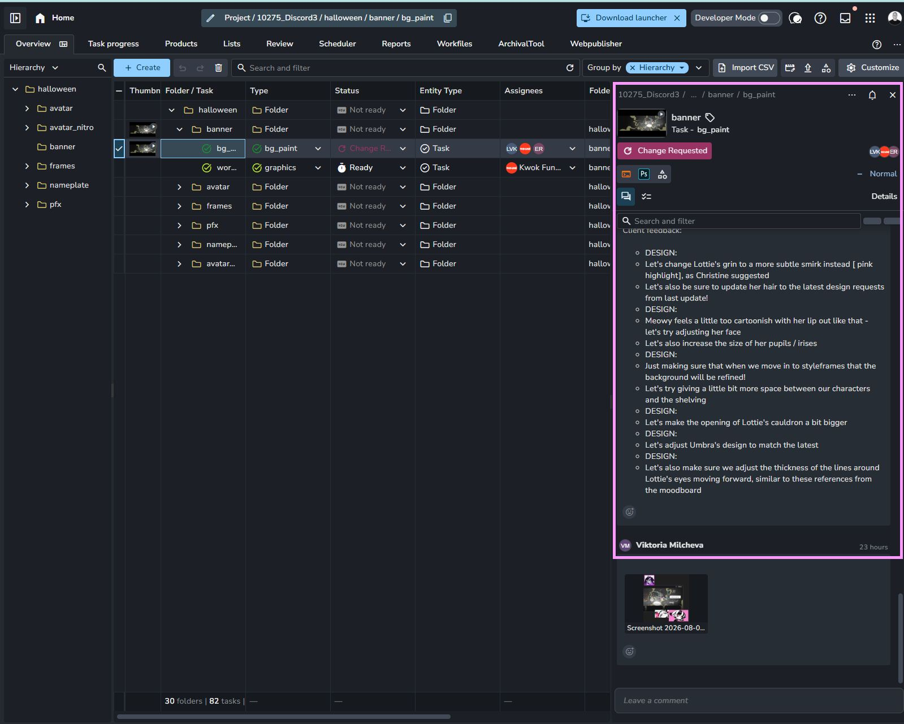

# Studio Dashboard Add-on

## Overview

This project implements a custom AYON Server Add-on.

The add-on provides a configurable dashboard panel within the AYON web interface for displaying studio information, announcements and pipeline tools.

The dashboard is intended to become the primary landing page for project communications and operational information.

---

# Integration

The addon will integrate into AYON as a custom frontend panel.

Preferred integration target:

* Should not appear on the studio root, only within a specific project

- Could be in a new tab called "Info" - first on the left if it is possible to set the tab order.
- The preference would be to add a new panel to the existing overview tab - like how the activity stream appears on the right.
- 

Future integration may include:

- Project page
- Header action button

The UI should remain independent of the integration location.

---

# Architecture

Python

Responsible for:

- addon registration
- settings
- REST endpoints
- business logic
- permissions
- data aggregation

React

Responsible for:

- rendering
- layout
- user interaction
- data presentation

React must never directly access database models.

Communication between frontend and backend should occur through REST endpoints.

---

# User Experience

The interface should feel like a native AYON page.

Use:

- AYON React Components
- existing typography
- existing spacing
- existing colour palette

Avoid introducing custom styling unless necessary.

---

# Design Goals

Fast loading.

Minimal clicks.

Clear hierarchy.

Responsive layout.

Simple navigation.

Support dark mode.

Avoid modal-heavy workflows.

---

# Initial Features

Studio announcement.

Pipeline message.

Useful links.

Documentation links.

Quick actions.

---

# Future Features

Deadline status.

AYON bundle information.

Pipeline health.

Recent publishes.

Studio metrics.

Miro integration.

GitHub integration.

Jira integration.

Project statistics.

Custom widgets.

---

# Technical Goals

Maintain clean separation between frontend and backend.

Use typed APIs.

Use Pydantic models.

Avoid duplicated logic.

Prefer reusable React components.

Prefer composition over inheritance.

Follow official AYON project conventions wherever possible.
