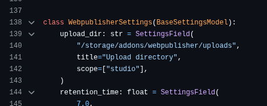

## AYON Media Storage Re-Jig

There's an issue with how project banners are stored. At the moment it's in the addon's version directory. Whilst this works, every update invalidated any stored project settings and banners. We need to fins a way to persist any settings that haven't changed in structure, as well as the banner stored for the project. 

- We should look at using the addon root, perhaps creating a `storage` folder here. this way, any addon version will reference a porject subfolder in storage , rather than the specifc addon version.
- AYON projects have a name, but it would be more sensible to use `project code` (which is unique) or if there's attribute data like a project ID or similar.

Some notes from an AYON server dev -

> you may use addon's private dir, but that way, it would be version dependent. probably better is to use the same approach as webpublisher and claim a directory - in the case of wp, this is configurable, but it should be somewhere in `/storage` preferably in `addons/addon_name` subdir.... addon then needs to implement both download and upload handlers + acl, but there are helpers in ayon server core, so it is just copy/paste

## Feature 

I'd like to add a new thumbnail component - for visual project *references*

Based on the banner upload, this might need to be added within the window itself, so we have to consider the workflow here.

#### Considerations

- is it hard for us to upload something and have any control of the size? We'd want a thumbnail to display as a reference on the page, but when clicked, see a popup of the actual image.
- Rendering a thumbnail server side sounds cumbersome, and tricky to track per project.
- one approach could be to have a setting where you enable the reference component in the settings - perhaps this front end component could then accept an image, and render the thumbnail via react/js. we'd then have to look at storing it inside the project folder with the banner.
- the react front end would have logic to look for refs in this folder and fallback by rendering nothing if it doesn't find the thumbnail and image for the ref.

So plan this as a 2 phase implementation and outline your thoughts

- stage 1 - reorganise the banner storage per project
- stage 2 - outline our options for this reference thumbnail component feature
