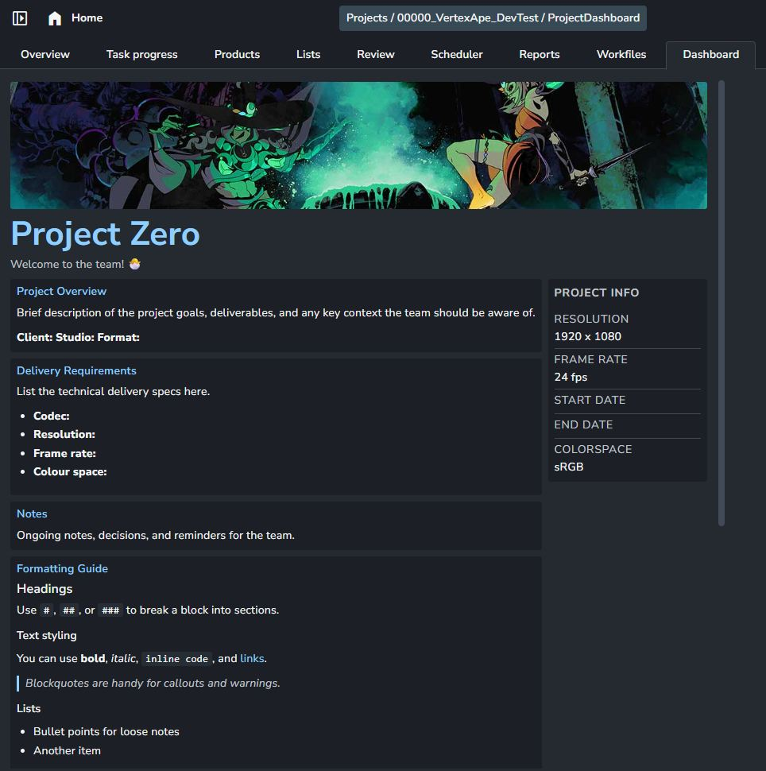
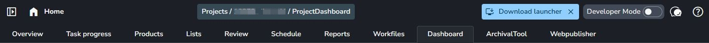
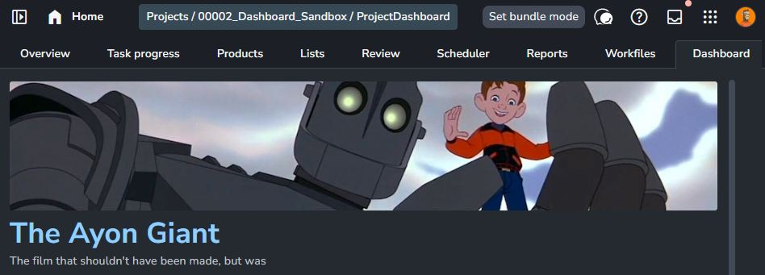
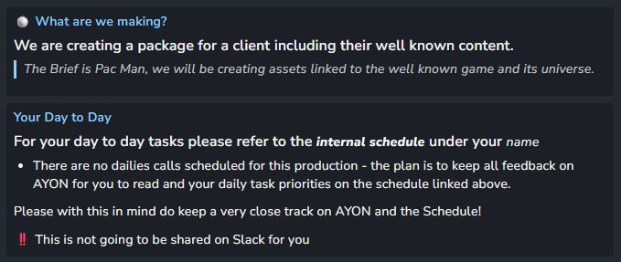
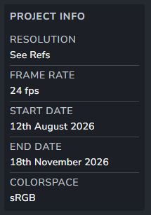
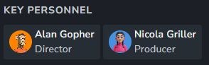
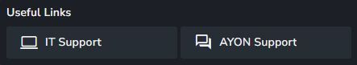
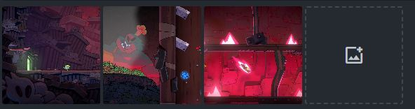
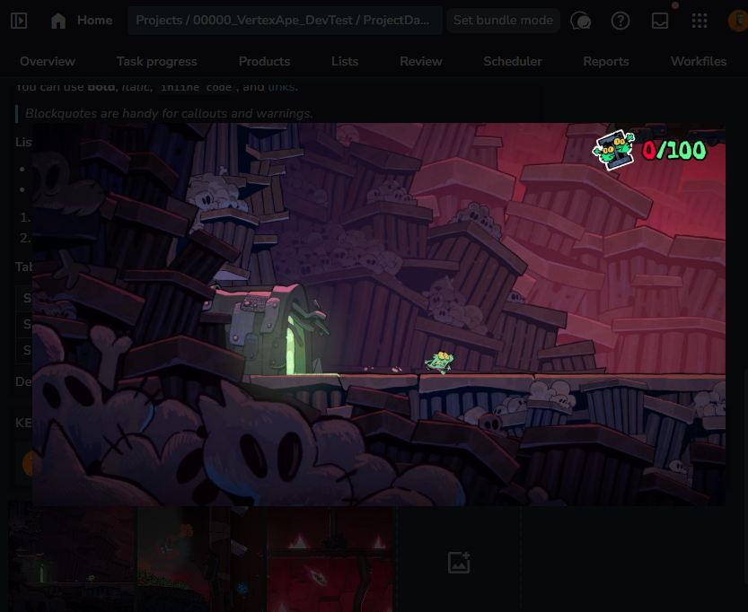

# AYON Project Dashboard

We are proud to use the [AYON](https://ynput.io) pipeline system here at THE LINE.

Part of our never-ending quest is to make our systems as artist-friendly as possible, whilst we try to create order from the chaos.



We felt that like many studios, we found key information was being stored in mutliple locations. AYON's modular approach means you can augment it with enhanced addon functionality that fits your studio. We felt we needed a place on every project that introduced what the project was about, important settings, key goals, and any useful information that an artist arriving on the project would want to know. 

This is Vibe Coded using Copilot/Claude Sonnet, but also released with actual human love from THE LINE ❤️

## What is it?

A server + frontend addon for [AYON](https://ynput.io) that adds a per-project "Dashboard" tab - a configurable overview page combining a banner, project summary, rich-text notes, key personnel, useful links, and a reference image gallery.



## Features

### Header & banner



- Custom project title and optional subtitle.
- Uploadable banner image (JPEG/PNG/WEBP/GIF, up to 5 MB), stored via AYON's own project storage (local disk or S3, whichever the server is configured for) so it works the same locally and on managed/cloud hosting.
- Upload/remove is restricted to project managers and admins.

### Rich Text Content Blocks



- Any number of free-form blocks, each with a title and Markdown content.
- Rendered with [`react-markdown`](https://github.com/remarkjs/react-markdown)

  + [`remark-gfm`](https://github.com/remarkjs/remark-gfm), so blocks support:

  - Headings (`#`, `##`, `###`)
  - **Bold**, *italic*, `inline code`, and links
  - Blockquotes
  - Bullet and numbered lists
  - Tables (GFM syntax)
  - Code blocks
- A "Formatting Guide" example block ships in the defaults demonstrating all of the above — edit or delete it once you're familiar with the syntax.

### Project summary



- A simple label/value list (e.g. Resolution, Frame Rate, Start Date,
  Colorspace) rendered as a compact info table.

### Key personnel



- A list of role → person entries (Director, Producer, Comp Lead, etc.).
- The username field is a searchable dropdown of real studio users (backed by AYON's built-in `users` enum resolver), so entries can't drift out of sync with actual AYON accounts)
- Each visible entry resolves to the user's display name and avatar at render time; clicking a tile shows a larger popup card.
- **Requires AYON server 1.15.0 or newer** (see [Requirements](#requirements)).

### Useful links



- A configurable grid of external links, each with a title, URL, icon, and
  whether it should open in a new tab.

### Reference images



- A small gallery (up to 6 images) of project reference thumbnails, with
  upload/remove restricted to managers and admins.
- Thumbnail size is configurable via settings.
- Click the thumbnail to expand the image (credits to [Deaths of Peck](https://www.deathsofpeck.com/))



### Visibility controls

- Reference images can be toggled on/off independently.

## Requirements

- AYON server `>=1.15.0` (needed for the Key Personnel username dropdown,
  which relies on the server's built-in `users` enum resolver).

## Known Issues

- AYON doesn't seem to be able to not render the tab on a project where the addon is part of the bundle, but not enabled. So if the Dashboard is disabled, you'll still see an (empty) Dashboard tab)
- We can't control which order the tab is rendered

## Settings

All settings live under `server/settings/models.py`
(`ProjectDashboardSettings`) and are rendered automatically by AYON's native Settings UI — both at the Studio level (defaults) and per-project (overrides). No addon-specific settings page exists outside of this.

## Development

### Frontend

```sh
cd frontend
yarn install
yarn dev      # local dev server
yarn build    # production build (also used by create_package.py)
```

Set `VITE_USE_MOCK_DATA=true` in `frontend/.env.local` to develop against the mock data in `frontend/src/dev/mockData.ts` without a running AYON server.

### Building an addon package

```sh
python create_package.py
```

This builds the frontend, syncs its version from `package.py`, and produces a ZIP under `package/` ready to upload to an AYON server
(`package/{name}-{version}.zip`). Use `--skip-zip -o <dir>` to produce an unzipped folder instead, or `--debug` for verbose logging.
